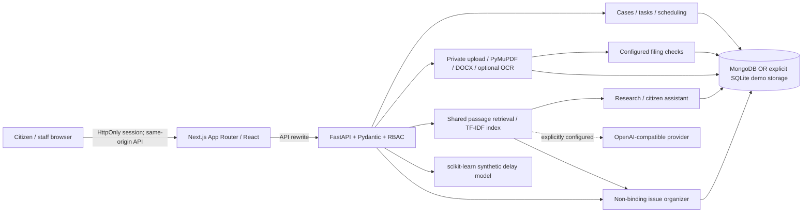

# NyayaAI — AI-Powered Judicial Assistance Platform

**Accessible Justice. Smarter Workflows. Responsible AI.**

A local, integrated hackathon prototype for citizens and court teams. All seeded cases, parties, tasks, hearings and administrative training labels are fictional. NyayaAI is **not an official court/government service**, legal representative, filing gateway or automated judge.

## What works

| Module | Interactive workflow |
|---|---|
| Smart Case Management | Permission-scoped registry; search, filters, pagination; staff case creation/status changes; timeline notes; task creation, editing, assignment and completion; conflict-aware scheduling with human confirmation. |
| Legal Research | Shared approved-source corpus, keyword/TF-IDF retrieval, passage identifiers and provenance, official links, insufficient-evidence response, extractive document summaries and downloadable JSON research briefs. |
| Filing Assistant | Private PDF/DOCX/image upload, bounded extraction and optional OCR, original-text inspection, editable reviewed metadata, per-document classification, configurable demo rules, traceable defects and printable/downloadable checklists. |
| Citizen Legal Assistant | Source-grounded procedural Q&A, persistent per-user history, uncertainty, follow-up question, general preparation checklists and verified official resources. |
| Predictive Analysis & Decision Support | Actual logistic-regression inference and prior baseline on reproducible synthetic data; metrics, bands, workload and filing history. Separate staff-only issue organizer compares user-supplied sides, traces assertions and material, flags gaps and saves a non-binding report. It abstains from unsupported outcomes. |

Also included: 36 sample cases, 3 citizens, 4 staff and an administrator; three editable dispute scenarios; dashboard counts from stored records; notifications/audit activity; responsive navy/white UI, accessible Radix tabs, skeleton/empty/error states; demo PDF generation; JSON downloads and browser print.

## Architecture

### Frontend appearance

Use the **Color theme** selector in the landing-page header, demo-login card or workspace header to select **Light**, **Dark** or **System**. System is the default and follows changes to the device color scheme. Your explicit preference is stored in this browser and synchronizes across tabs; no account data or backend configuration changes. If browser storage is blocked, switching still works for the current tab. The initial theme is applied before page hydration to avoid a light flash, and printed reports retain a light palette. Charts, forms, source passages and shared module panels support both appearances.



### Stack

- Frontend: Next.js 15 App Router, React 19, strict TypeScript, Tailwind CSS 3, accessible Radix UI tabs, Lucide, Recharts.
- Backend: Python, FastAPI, Pydantic, PyMongo, SQLite standard library for explicit local demo persistence.
- Documents: PyMuPDF, python-docx, Pillow, optional pytesseract/Tesseract.
- Retrieval/modeling: scikit-learn TF-IDF/cosine similarity, logistic regression and DummyClassifier. No large local model or automatic model downloads.
- Testing: pytest/FastAPI TestClient; Playwright browser workflows.

## Prerequisites

- Windows 10/11, Node.js 20.9+ (Node 22/24 recommended), npm.
- Python 3.11+ with pip; Python 3.14 is supported by the wheels used in this environment.
- MongoDB Community Server or Atlas **only if selecting MongoDB mode**. SQLite demo mode needs no service.
- Tesseract executable only for scanned PDFs/images. Text PDFs and DOCX work without it.
- Initial package installation needs network access. Thereafter the deterministic demo and curated corpus work offline.

## Exact Windows setup (PowerShell)

The commands below use this workspace's absolute path. Adjust `$Repo` if you clone elsewhere.

```powershell
$Repo = 'C:\Users\ARNAB\Desktop\coding club\cline ai\NyayAI-Reforming-Indian-justice-system-through-AI'
Set-Location "$Repo\backend"
py -m venv .venv
Copy-Item .env.example .env
& .\.venv\Scripts\python.exe -m pip install -r requirements.txt
& .\.venv\Scripts\python.exe -m app.seed
& .\.venv\Scripts\python.exe -m app.demo_samples
& .\.venv\Scripts\python.exe -m uvicorn app.main:app --host 127.0.0.1 --port 8000
```

In a **second** PowerShell terminal:

```powershell
$Repo = 'C:\Users\ARNAB\Desktop\coding club\cline ai\NyayAI-Reforming-Indian-justice-system-through-AI'
Set-Location "$Repo\frontend"
Copy-Item .env.example .env.local
npm ci
npm run dev
```

Open **http://localhost:3000**. API health: **http://127.0.0.1:8000/api/health**. Interactive OpenAPI: **http://127.0.0.1:8000/docs**.

Virtual environment activation is optional; the commands call its Python directly, avoiding PowerShell execution-policy problems. Keep the API on one worker for this prototype's scheduling lock. `npm run build` then `npm run start` runs the production frontend.

After dependency installation and a successful frontend build, an optional launcher seeds the demo packages and starts both production-mode processes with local log files:

```powershell
& 'C:\Users\ARNAB\Desktop\coding club\cline ai\NyayAI-Reforming-Indian-justice-system-through-AI\scripts\start-demo.ps1'
```

The launcher refuses occupied ports rather than killing existing services. Use the two-terminal commands above if your PowerShell execution policy blocks local scripts.

## Storage configuration

The default is **explicit persistent SQLite demo mode**, reported by health, Settings and the dashboard. This is not an in-memory mock and is not a silent fallback from MongoDB. Records live in the private backend data directory. MongoDB connection failures return clear 503 responses; no successful writes are fabricated.

### MongoDB

Install/start MongoDB Community Server using its Windows service, or supply an Atlas connection string in the backend `.env`:

```dotenv
STORAGE_MODE=mongodb
MONGODB_URI=mongodb://127.0.0.1:27017
MONGODB_DATABASE=nyayaai_demo
```

Restart the backend. With a local service installed, `Get-Service MongoDB` shows status; starting the service may require an elevated terminal: `Start-Service MongoDB`. Never commit an Atlas credential or put it in the frontend environment. Data is seeded in the selected storage backend, not copied between modes.

Collections: users, sessions, cases, documents, sources, filings, tasks, predictions, reports, audit, research, conversations. Stable case/user seed IDs; generated documents/reports use random internal IDs. MongoDB indexes cover IDs, owner/case keys and common case filters. SQLite uses a collection/ID primary key. Demo filtering reads bounded-size collections in application memory; this is not a production-scale query layer.

## Environment variables

Backend template: `C:\Users\ARNAB\Desktop\coding club\cline ai\NyayAI-Reforming-Indian-justice-system-through-AI\backend\.env.example`

| Variable | Default / purpose |
|---|---|
| `STORAGE_MODE` | `sqlite`; explicitly choose `mongodb` for MongoDB. |
| `DATA_DIR` | Defaults to absolute backend `data` directory. If explicitly relative, resolves against server working directory. Stores SQLite and private uploaded files. |
| `MONGODB_URI`, `MONGODB_DATABASE` | Database connection; used only in MongoDB mode. |
| `DEMO_LOGIN` | `true`; enables public fictional-account selection. Set false to disable all login; a production identity provider is **not** implemented. |
| `FRONTEND_ORIGIN` | `http://localhost:3000`; exact allowed browser origin. |
| `COOKIE_SECURE` | `false` for local HTTP; use true with HTTPS. |
| `LLM_PROVIDER` | `demo` or `openai-compatible`. |
| `LLM_BASE_URL` | Trusted OpenAI-compatible API base, default `https://api.openai.com/v1`. |
| `LLM_MODEL` | Provider model name, default `gpt-4o-mini`. |
| `LLM_API_KEY` | Empty by default. Backend-only secret. |
| `TESSERACT_CMD` | Optional absolute path to `tesseract.exe`. |

Frontend template: `C:\Users\ARNAB\Desktop\coding club\cline ai\NyayAI-Reforming-Indian-justice-system-through-AI\frontend\.env.example`

`BACKEND_URL=http://127.0.0.1:8000` is a **server-side** Next.js rewrite destination. No public API key or browser token variable is needed. Restart/rebuild Next.js after changing the rewrite destination.

## Demo login, seeding and reset

Open a workspace and select Citizen 1/2/3, Registry Officer 1/2 or Administrator. Staff 3/4 are also seeded and available to the API. There are **no passwords**: this is intentionally public fictional-account selection, not password authentication. No production credentials are hardcoded.

- Citizens: only their own sample cases/documents/filings; no staff mutations or decision-support access.
- Staff/admin: fictional registry operations, tasks, scheduling, delay metrics and decision support. Admin currently has the same privileges as staff.
- Session: opaque random token in HttpOnly/SameSite=Strict cookie, hash stored server-side, 8-hour expiry, explicit revocation on logout.
- State-changing requests require `X-Nyaya-Request: 1` and reject a conflicting Origin. The frontend adds this automatically; API clients must do so too.

Seed automatically runs on initial successful startup, or manually:

```powershell
$Repo = 'C:\Users\ARNAB\Desktop\coding club\cline ai\NyayAI-Reforming-Indian-justice-system-through-AI'
Set-Location "$Repo\backend"
& .\.venv\Scripts\python.exe -m app.seed
# Destructive: stop servers first; clears records/sessions in selected demo database.
& .\.venv\Scripts\python.exe -m app.seed --reset
```

Reset rebuilds 36 cases with stable IDs and dates relative to the reset date. It invalidates sessions. Unreferenced upload files are not automatically deleted; delete the private uploads directory manually only after stopping the server if you want to reclaim space. Never point reset at a non-demo database.

The complete/defective sample PDF links in Filing Assistant generate readable synthetic PDFs. Three seed scenarios repeat across sample cases: damaged desk delivery, rental deposit and service invoice.

`python -m app.demo_samples` additionally creates two persisted demo filing packages and three private text PDFs, using stable IDs: a complete package for case-001/Citizen 1 and a defective package for case-002/Citizen 2. This optional command is idempotent. After reset, rerun it if you want preloaded filing reports. Browser-upload actions remain available for live demonstration.

## AI, provenance and demo mode

With no credentials, research/assistant return **clearly labeled retrieved excerpts** and deterministic next steps. Summaries are extractive. The decision workflow is an **experimental deterministic issue organizer**, not a live LLM judge.

To enable optional live research/assistant answers, set `LLM_PROVIDER=openai-compatible`, a trusted `LLM_BASE_URL`, `LLM_MODEL` and `LLM_API_KEY` in the backend environment and restart. Only retrieved approved passages and the question are sent. Responses must provide identifiers matching retrieved passages; provider failure or mismatched citation IDs triggers an explicit demo fallback. Citation-ID validation does **not** prove that a model's claim is substantively supported; human review remains essential. Do not send confidential questions to a provider.

Initial approved corpus:

1. https://nalsa.gov.in/ — official homepage excerpt about legal services and Lok Adalats.
2. https://services.ecourts.gov.in/ecourtindia_v6/ — official CNR/case-status search instructions.

Both were retrieved during implementation on **2026-10-10**. Unknown publication/effective dates remain null; a website update date is not treated as a law's effective date. No statutes, judgments, precedent identifiers or eligibility rules have been invented to fill the corpus. See the sources section in research results.

Passages retain stable source/passage IDs, overlap for context and metadata. TF-IDF artifacts are cached per corpus and deterministically rebuilt after restart/change. Semantic embeddings/FAISS are **not implemented**; lexical similarity is labeled honestly. Local document ingestion exists as a staff API but is quarantined and excluded from shared retrieval to prevent publishing private case material. A provenance-approval UI is not implemented.

Decision reports trace user assertions and extracted document sections, present both sides, flag text-pattern disputes and explicitly retain uncertainties. The small corpus cannot establish applicable substantive legal elements, admissibility, burden or standard of proof; the organizer abstains from outcome assessments. It does not infer witness credibility, authenticate evidence or claim independent fact verification.

## Administrative model card

- Reproducible 900-row synthetic dataset, NumPy seed 42.
- Features known at snapshot time: days since update, adjournments, pending tasks, missing procedural documents. No protected characteristics or outcome/merits labels.
- Target: synthetic procedural milestone **not completed within the next 30 days**.
- Training: first 600 snapshots, 30-snapshot embargo, final 270 chronological test snapshots. The embargo keeps training label windows before test snapshots.
- Compare standardized logistic regression with a training-prior DummyClassifier; report precision, recall, F1, Brier score.
- Labels come from a designer-specified probabilistic process, not court outcomes. Synthetic performance has no claim to real-world validity.
- Bands: low <0.35, moderate 0.35–0.649, high ≥0.65. Rule alerts explain observable administrative gaps, not causal SHAP attribution or legal priority.
- Model trains lazily once per process; dataset regenerates deterministically. No pickle loading or untrusted serialized model execution.

## API reference

Generated schemas and all routes: http://127.0.0.1:8000/docs (`/openapi.json`). API writes need the CSRF header above; sign in through `/api/auth/login` and retain cookies.

| Area | Routes |
|---|---|
| Health/auth | `GET /api/health`; `POST /api/auth/login`, `/logout`; `GET /api/auth/me` |
| Cases | `GET/POST /api/cases`; `GET/PATCH /api/cases/{id}`; `GET /api/cases/{id}/timeline`; `GET /api/users/staff` |
| Tasks | `POST /api/cases/{id}/tasks`; `PATCH /api/tasks/{id}` |
| Documents | `POST /api/filing/upload` (multipart case_id/file); `GET /api/documents/{id}`, `/{id}/download`; `GET /api/demo/sample-document?kind=valid` |
| Filing | `POST /api/filing/check`; `GET /api/filing/{id}`, `/{id}/report` |
| Research | `POST /api/research/search`, `/summarize`, `/brief`, `/ingest`; `GET /api/research/sources/{id}` |
| Assistant | `POST /api/assistant/chat`, `/checklist`; `GET /api/assistant/history` |
| Scheduling | `GET /api/staff/schedule`, `/api/staff/alerts`; `POST /api/staff/schedule/suggest`, `/approve` |
| Analytics | `GET /api/analytics/overview`, `/model-metrics`; `POST /api/analytics/delay-risk` |
| Decision support | `POST /api/decision-support/analyze`; `GET /api/decision-support/reports/{id}?download=true` |
| General | `GET /api/notifications` (authorized pending tasks and safe audit events) |

Case filters: `q`, `status`, `category`, `stage`, `assigned_staff`, `filed_after`, `hearing_before`, `pending_tasks`, `page`, `page_size` (max 100). Input schemas reject unknown fields. Exports are JSON or browser-printable UI, not DOCX/PDF report generation.

## Tests and build

```powershell
$Repo = 'C:\Users\ARNAB\Desktop\coding club\cline ai\NyayAI-Reforming-Indian-justice-system-through-AI'
Set-Location "$Repo\backend"
& .\.venv\Scripts\python.exe -m pytest -q
Set-Location "$Repo\frontend"
npm run typecheck
npm run build
npx playwright install chromium
npm run test:e2e
```

Playwright starts local servers (or reuses running ones) and uses the actual application with demo storage. Browser tests create sample tasks/documents/reports; reset afterward if desired. Backend tests use isolated temporary SQLite databases and mock provider/OCR failures; no paid service or live legal retrieval is required. An installed Edge can be used instead of downloading Chromium: `$env:PLAYWRIGHT_CHANNEL='msedge'; npm run test:e2e`.

See `C:\Users\ARNAB\Desktop\coding club\cline ai\NyayAI-Reforming-Indian-justice-system-through-AI\docs\validation.md` for checks actually executed, and `C:\Users\ARNAB\Desktop\coding club\cline ai\NyayAI-Reforming-Indian-justice-system-through-AI\docs\demo-script.md` for the 5–7 minute demonstration.

## Security, privacy and known limitations

- Demo login is public by design. Keep this on localhost, use synthetic data, and do not deploy with real case information. Production SSO/password authentication, account provisioning and password recovery are not implemented.
- Authorization is enforced in the API, not just hidden navigation. Case/document/filing IDs are checked for ownership; reports and staff actions require staff role. Local-source ingestion does not expose private uploads through public research.
- Uploads are outside public directories with random internal filenames; validated extensions/signatures, 10 MB file limit, 20-page PDF limit, bounded text/image/archive expansion. DOCX is never executed; PDFs are not executed. Antivirus, sandboxing and production streaming-body limits are not implemented; do not expose upload endpoints to untrusted internet traffic.
- Missing OCR yields a failed processing record and actionable warning, not pretend analysis. No calibrated extraction confidence is claimed. English OCR only by default; handwritten/multilingual documents are not validated.
- Original document assertions are retained; users correct reviewed filing metadata and analysis input, not immutable original bytes. Automated extraction of people, legal elements or evidential credibility is not claimed.
- Corpus currently contains two official guidance excerpts, not a full statutory/judgment database. No live eCourts integration, filing submission, notifications email/SMS, official holiday calendar or actual officer availability.
- Scheduling uses one-process locking; **run a single backend worker**. Multi-worker transactional booking and atomic case/document/audit writes are not implemented. A multi-record failure can leave partial state and returns an error; inspect/reset demo data rather than assuming success.
- SQLite/MongoDB records are persisted, but encryption at rest, retention policies, backup/restore UI, malware scanning and production compliance review remain future work.
- Assistant history persists, but each question is answered independently; full context-aware conversation orchestration is not implemented.
- Filing rules are a deliberately scoped configurable exercise, not official acceptance/rejection rules; name checks are exact-string flags, not identity matching.
- Predictions are synthetic administrative experiments. Decision analysis is deterministic and conservative, not an empirically validated judicial model. No guilt/verdiction probability or binding outcome is issued.
- Research/provider calls have bounded timeout and demo fallback. Citation identifier matching is not entailment verification; live responses may still need correction.
- JSON exports and browser print are supported; automatic PDF/DOCX report exports are not.
- The production dependency audit is checked separately from development tools. Tailwind 3's development-only glob/selector dependency chain currently reports advisories; do not process untrusted CSS or filesystem glob patterns. See the validation report for exact audit results. Production PostCSS is pinned through an override to a patched release.

## Troubleshooting

| Symptom | Action |
|---|---|
| Frontend says server unavailable | Start FastAPI on 127.0.0.1:8000, check health and `BACKEND_URL`; restart Next after env changes. |
| MongoDB 503 | Start MongoDB/check URI/network access. Alternatively explicitly choose `STORAGE_MODE=sqlite`; restart. No silent fallback occurs. |
| CSRF/origin rejection | Use http://localhost:3000 consistently, or set matching `FRONTEND_ORIGIN`; add `X-Nyaya-Request: 1` for API writes. |
| Login disabled | Check `DEMO_LOGIN=true`. With it false there is intentionally no production login fallback. |
| OCR unavailable | Install Tesseract, set `TESSERACT_CMD=C:\Program Files\Tesseract-OCR\tesseract.exe`, restart; use a text PDF in the meantime. |
| Extraction failed | Check encryption/type/size/page limits. Failed files are stored but not reported as analyzed; replace with readable material. |
| No research results | Try legal aid/CNR/case status/Lok Adalat. The small corpus intentionally cannot answer unrelated law questions. |
| Case inaccessible | Citizen accounts have separate ownership. Sign into staff only for fictional authorized registry operations. |
| Port busy | Stop the previous local process or update backend port and frontend rewrite together. |
| Slow Python package downloads | Allow installation to finish; wheels such as SciPy/PyMuPDF are large. An existing compatible Python environment can be reused, but isolated venv is recommended. |
| PowerShell activation blocked | Use `.venv\Scripts\python.exe` directly as documented; activation is not required. |
| Browser download unavailable | Use installed Edge via `PLAYWRIGHT_CHANNEL=msedge`; report browser-test limits honestly if no browser exists. |

## Responsible AI disclaimer

NyayaAI provides experimental information organization and administrative assistance. It is not endorsed by the Government of India, judiciary, NALSA or eCourts. Official links indicate provenance, not endorsement. It does not replace qualified legal advice or human judicial authority. Verify current law, source applicability and facts independently. Never use synthetic model performance to rank human worth, determine guilt, decide punishment or deny access to justice.